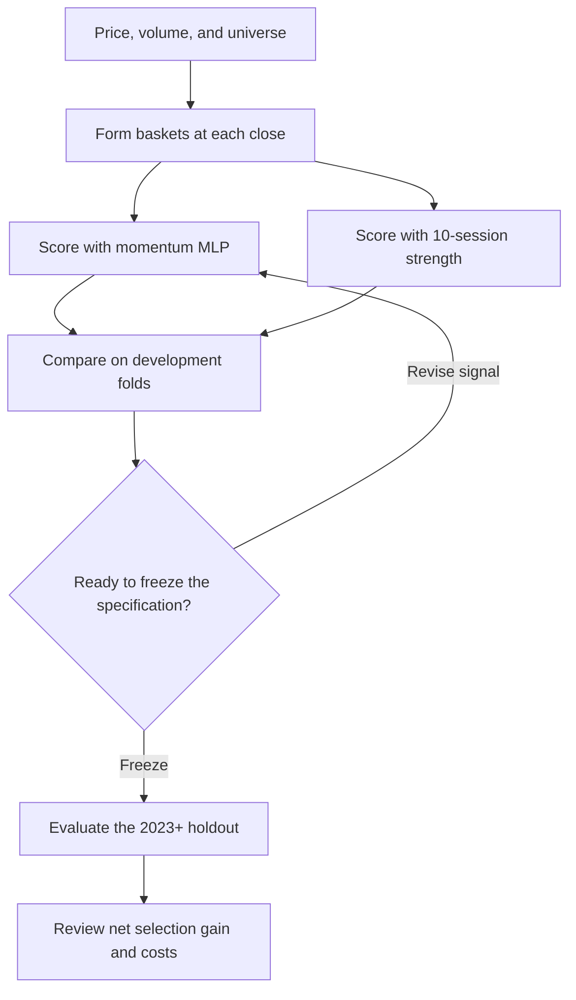

# Equity Theme Rotation Pipeline

Can we select two stock baskets that outperform an equal allocation across the eligible baskets over the next five sessions? The leading candidate is hierarchical clustering (HC) followed by a small MLP with 7–14-session momentum acceleration and weight decay of `0.1`. The January 2023 onward holdout is still sealed.

## Research workflow

## Work board

| Stage | Status | Current decision | Next action |
|---|---|---|---|
| Data and universe | Usable for development | BAB Stage 2.7 adjusted closes, volume, and SPY. The stock list is a current-constituent snapshot. | Document membership bias. Evaluate a historical point-in-time universe when available. |
| Basket construction | Baseline | HC uses 60 trailing sessions, cuts to 10 groups, and keeps groups with at least three names. | Keep HC for the candidate comparison. Fixed industry groups remain an open benchmark. |
| Signals | Candidate | Replace 10-session relative strength with 7–14 momentum acceleration. The other three inputs are breadth, unusual volume, and persistence. | Freeze the four feature definitions and confirm they use information available by the signal close. |
| Forecast | Candidate | MLP with four inputs, eight ReLU units, MSE, and decoupled weight decay of `0.1`. Development metrics average three independent initializations. | Decide how to produce exactly one live ordering per session, then test that scoring rule on development data. |
| Development validation | Complete for this candidate | Expanding 2015–2022 folds with five-session label purging. Rank IC was `+0.0223`. Top-two selection gain was `+10.11 bps` over equal basket allocation, before costs. | Retain the daily 10-session strength benchmark and the equal-basket benchmark for holdout. |
| Execution simulation | Proposed | Signals are known at the close. Entry at the next available open is the proposed fill assumption. | Confirm usable open prices, exit timing, how to combine overlapping five-session positions, and cost assumptions. Validate the simulator on development data. |
| Final holdout | Sealed | January 2023 onward. | Freeze the scoring and execution rules, then evaluate the frozen specification against the benchmarks. |

## Feature decisions

| Experiment | Decision | Evidence |
|---|---|---|
| HC vs PCA + K-means | Keep HC as the baseline | PCA reduced the median largest basket from 79.4% to 16.3% of eligible names. The paired Rank IC comparison was inconclusive. |
| 10-session strength | Keep as a benchmark | Direct ranking scored `+0.0179` Rank IC on the HC development sample. |
| 21-session strength, equal weights | Tested | Direct top-two gain was `+3.23 bps`. Adding it to the existing Ridge model reduced Rank IC. |
| 21-session exponential weighting | Parked | A seven-session half-life gave similar results to equal weighting over 21 sessions. |
| MLP weight decay `0.1` | Retain in candidate | Raised top-two selection gain by `+1.54 bps` versus the original MLP. The Rank IC improvement was inconclusive. |
| Momentum acceleration, 7 recent vs 14 prior sessions | Leading candidate | With decay held fixed, increased top-two gain by `+9.05 bps` versus the 10-session MLP. The paired 95% interval was `+2.01` to `+16.92 bps`. |
| Options volume and reversal filters | Proposed | Test each as a separate change after the current candidate decision. |

## Decisions before holdout

| Open decision | Proposed rule |
|---|---|
| One score per basket | Average raw forecasts across the three fixed MLP seeds, then rank once. Validate this rule on development data. |
| Evaluation metric | Use the net gain of the top two versus equal allocation across the eligible baskets as the primary metric. Report the 10-session strength comparison and Rank IC as supporting metrics. |
| Execution and costs | Record entry, exit, position overlap, turnover, and cost assumptions before running the holdout. Report gross and net results under identical execution for all benchmarks. |
| Decision rule | Use the paired confidence interval for net selection gain along with the gain itself. Treat results whose interval crosses zero as inconclusive. |

**Next task:** Reproduce the development results with one deployable ranking per date, then fill in the execution assumptions above. Update this board with the decision and the run that supports it.

## Code and results

- [Basket construction and labels](baskets.py)
- [Ridge validation and scoring](evaluate.py)
- [HC vs PCA comparison](compare_baskets.py)
- [Weight-decayed MLP and 7–14 signal](compare_momentum.py)
- Local development summary at `results/momentum_acceleration/summary.json`
